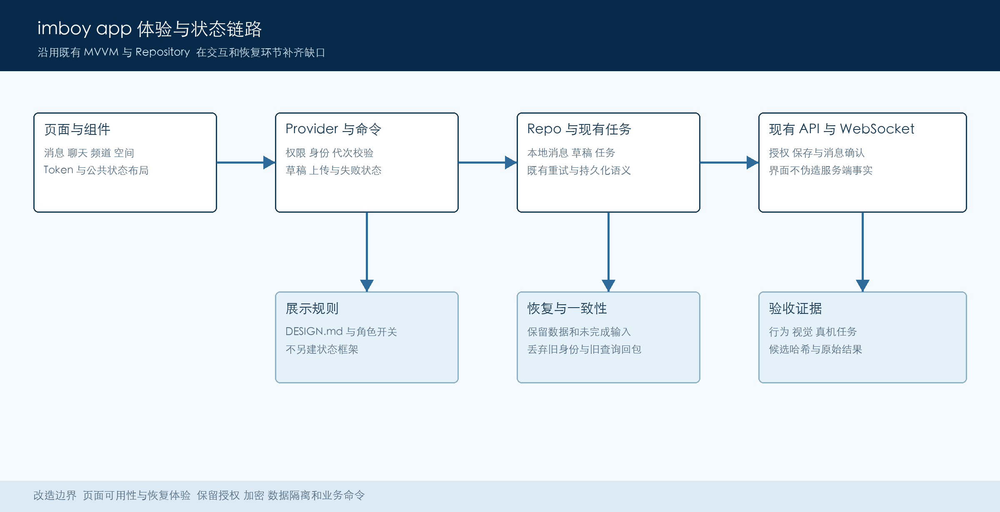

# Imboy App UI/UX Optimization Plan

> The original plan was prepared on 2026-11-11. Refer to the PR description and review ledgers for actual progress and outstanding acceptance items. The Chinese version is authoritative.

| Status | Owner | Updated |
|---|---|---|
| Proposal V1 | To be assigned | 2026-11-11 |

| | |
|---|---|
| **Prepared by** | Codex, based on the repository source and standards |
| **Review** | Joint review by product, Flutter, and test leads is recommended |
| **Basis** | DESIGN.md, page review ledger, and test execution contract |
| **Scope** | High-frequency mobile experiences and state recovery, with enterprise spaces and cross-platform consistency |

# 1. Summary

Retain the existing native iOS feel and brand blue. First fix issues that can cause unintended actions, lost drafts, or failures without a way out; then align interactions for messages, chat, channels, and space switching. Existing standards and shared components are relatively complete. The priority is making the designed capabilities reliable in real scenarios.

This was a planning deliverable. The source baseline was imboyapp `da7ae435e738d463c38dbd778315622d6d6987f7`; the worktree was clean when inspection began. The primary users are personal chat users and enterprise members; administrators and customer service retain their respective permissions. All targets here are proposed acceptance values. No App functional tests or user tests were run for this planning work.

# 2. Goals and Scope

| **Goal** | **Scope for this phase** |
|---|---|
| Complete key tasks: selection, editing, and retry each have a reliable exit | Fix verified paths first; do not create changes based on page counts |
| Make primary content clear: prioritize messages and keep space identity visible | Preserve personal and enterprise entry points and existing feature flags |
| Complete core tasks on narrow screens, with large text, in dark mode, and with screen readers | Reuse tokens and components; do not replace the brand or rebuild the theme |
| Make changes regression-testable, incremental, and reversible by feature | Do not change protocols, permissions, or encryption policies, or add a persistence layer |

## 2.1. Local Integration Addendum (2026-11-14)

The original plan and UX01–UX06 acceptance requirements remain. The user's later message selection and forwarding screenshots are included in this App delivery: cancellation and selected count, clear selection states, and a bottom action area and forwarding sheet following the reference. Individual and merged forwarding must retain the existing messaging, attachment authorization, and encryption paths. Recheck current message state when confirming the sheet; revoked, ineligible, and undecryptable messages must not be forwarded. Additional actions must represent implemented capabilities.

Use App main `6b4ae832dbab8f367298c3dd24dec2825abb8dac` as the integration starting point, bringing in the space menu fix, the adopted complete set of 406 Golden baselines (394 images differ from this integration base), selection interactions, and required test fixes while preserving main's forwarding security behavior. Results for Draft PR `a9095a5` and other source fingerprints remain historical evidence and do not count as acceptance of the new candidate.

Acceptance still requires the Xiaomi physical device journeys for selection, cancellation, sheet dismissal, and cross-account individual and merged forwarding, including narrow screens, large text, dark mode, and screen readers. Verify received message count, order, content, and attachment permissions. Complete the original six parent journeys and applicable full checks; specialist passes do not replace overall acceptance. The running backend must support merged forwarding and be verifiably bound to frozen inputs, runtime artifacts, and the test endpoint. This addendum claims no acceptance pass and does not change the parallel Web MVP scope.

# 3. Current Foundation and Assessment

The personal bottom navigation already includes Messages, Contacts, Channels, and Me; Channels is controlled by a feature flag. The message page has a unified list, filters, long-press actions, and local failure prompts; the space menu has switching-busy and retry states; settings and profiles use grouped layouts. Preserve these capabilities and complete their verification rather than rebuilding them.

DESIGN.md references 221 distinct page-hosting files and 563 check records. The CSV actually has 226 rows, including extra page classes and exclusions, so this is not directly a page count or a pass count. The ledger includes review baselines such as `8423aeaa` and `fd4d7671`, which must be checked against current source item by item. The six items below were statically sampled for this plan and describe reachable risk paths that still require controlled reproduction.[^1]

| **Priority and ID** | **Current risk** | **Improvement and behavioral acceptance** |
|---|---|---|
| P0 UX01 Location selection | Changing the search term clears the list and index but retains the previous send target | Clear the prior selection; require a new selection; never send A when B has no results |
| P0 UX02 Channel draft | A late load directly overwrites name, tags, and avatar state | Separate loading and editing; old responses must not overwrite input; warn about unsaved changes on exit |
| P1 UX03 Channel avatar | A failed upload leaves a preview of the new file while save may still use the old address | Distinguish local preview, uploading, failed, and synchronized states; allow retry or restore |
| P1 UX04 Friend selection | Busy ends only on the success path and exceptions leave no page-level exit | Stop loading and show retry on error; show an empty state for a successful empty result |
| P1 UX05 Embedded web page | No container progress when a title exists; errors only invoke a callback and provide no page recovery | Show retry and back for main-document failures; do not treat resource errors as a whole-page failure |
| P2 UX06 Unified search | Desktop contact, group, and conversation search errors return empty lists | Retain successful groups and allow failed groups to retry; separately inspect similar mobile paths |

# 4. Experience Architecture and Page Design

Figure 1. Optimization points in existing page and data flows.

### Module Responsibilities and Change Locations

| **Module** | **Interface changes** | **Existing capabilities** | **Failure and recovery** |
|---|---|---|---|
| Messages and search | Clear identity, title, preview, and unread hierarchy | MessageInboxTile and filter bar | Preserve loaded conversations and retry locally |
| Chat and attachments | One primary send action, inline progress, and failure entry point | Existing chat_input retry and attachment authorization | Preserve draft; retry only failed items |
| Channels and group collaboration | Editing protection, upload consistency, and role-based actions | channel_edit and the existing publishing queue | Do not mark an unconfirmed submission successful |
| Spaces and enterprise | Keep current space visible; switch within the menu | workspace_drawer_menu and switching controller | Retain original space on failure and discard stale responses |
| Me and shared containers | Form feedback, web recovery, and accessibility | ios_settings_ui and AsyncStateView | Allow scrolling, back navigation, and retry |

**Messages.** Retain All, Unread, Private Chat, Group Chat, and Channels, as well as local name or preview search. Keep a clear entry to message-history search. Prioritize titles over previews and timestamps; move metadata beneath the preview at large text sizes. Filtering must not advance read status; retain undo for hiding channel directory entries.

**Chat.** Keep conversation identity and back navigation at the top, and text, voice, and attachment entry points at the bottom. Show sending status and provide in-place retry for failed messages. Do not lose input when switching between the system keyboard and tool panels. An upload failure must not clear pending content, and sent items must not be delivered twice.

**Channels and groups.** Offer browsing, subscription, and management entry points according to role. Saved edits must correspond to the current draft. If avatar upload fails, clearly state that it has not been uploaded and allow retry or restoration. Member search must state whether it covers all members or the current page; filtering the current page must not masquerade as a full search.

**Spaces and Me.** Personal or enterprise identity must be recognizable before and after switching. Allow only one switch at a time and retain the original space on failure. Group settings into profile, security and privacy, notifications, and account management. Explain the subject and consequences of dangerous operations and retain confirmation steps.

**Visual rules.** Keep the distinction between brand blue and system blue; use `primaryDark` for solid page-level primary buttons. Continue using AppColors, AppSpacing, and FontSizeType. Do not rely on gray alone to express a disabled or error state. Use neutral surfaces and fine separators for light and dark themes; avoid decorative cards.

# 5. Core Journeys and Interaction Details

1. **Find and reply to a message.** Identify the space on entering Messages, filter or search, and open a conversation. After sending, update status using existing message receipts. Acceptance covers private chat, group chat, and personal channels; search and filtering must not clear unread status or include unauthorized content.
2. **Send a location.** After selecting A, changing the search to B must immediately clear A. While B is loading or has no results, the old location cannot be sent and the UI must explain “Please select a location.” Submission requires a selection from current results; rapid term changes accept only the latest query result.
3. **Edit a channel.** Show existing content when entering with a cache. Once editing makes the draft dirty, background refreshes must not overwrite it. Prevent duplicate saves; preserve the draft on failure; verify success against the returned model. Both back gestures and back buttons must check for unsaved changes.
4. **Change an avatar.** Indicate uploading after selection. On failure retain a recoverable draft, clearly state it is not synchronized, and offer retry and restore. Resolve a failed avatar state before saving; do not report complete success when a new preview accompanies an old saved value.
5. **Recover from load failure.** Initial friend selection and web failures show the cause and retry. A failed refresh preserves existing data and shows an in-place message. Show empty states only for successful, genuinely empty responses; error messages offer user actions rather than raw exception strings.
6. **Switch spaces.** Open the menu from the global space entry and show switching after choosing a target. Update the current space and close that menu only on success. Retain the current space and cache on failure. After account switching or logout, old requests must not write data into the new identity.
7. **First use and sensitive actions.** Place login validation near the relevant fields. Explain recording, camera, or location permissions when used, and provide a system-settings entry after denial. Retain security policies for new-device key recovery and backup; improve only explanations and recovery entry points without weakening protection.

# 6. UI State and Data Contracts

### State Sources and Display Requirements

| **State or identity** | **Source** | **Applies to** | **UI contract** |
|---|---|---|---|
| Space identity | Account and server | Global | Isolate by account, server, and space together; retain original identity if switching fails |
| Loading state | Provider or request | Lists | Distinguish initial load, refresh, and more; retain successful content |
| Errors and empty results | Actual response or exception | Lists | Show empty state only for successful empty results; offer recovery on failure |
| Draft state | Current editing session | Forms | Old responses cannot overwrite a dirty draft; exit can preserve or discard it |
| Upload state | Existing attachment task | Media | Distinguish local, uploading, failed, and complete; preview reflects state |
| Message state | Message storage and receipts | Messages | Separate actual unread status from manually pending items; do not fabricate receipts |
| Permission state | Server facts | Management | Button text, appearance, and semantics match actual availability |

### Interface and Compatibility Guarantees

1. This table describes display semantics; it does not require new fields with the same names or a unified state engine. Prefer existing models. Only when a model cannot distinguish empty results from failure should the relevant Provider be extended and its callers checked.
2. Continue using existing API, WS, Repo, and attachment task identifiers. Keep message IDs as String; do not convert them to int or infer permissions from UI ordering or cache.
3. Channel save, location selection, and space switching must check the current account, target, and request generation; old-query or old-identity responses must not update the current UI.
4. UI feedback does not replace server confirmation. Retry calls the existing command; if a receipt is missing, first check through the existing path and retry only after confirming it is safe.

Contracts are based on existing repository implementation and DESIGN.md; API changes require separate review.

[Official reference: Flutter accessibility UI design and styling](https://docs.flutter.dev/ui/accessibility/ui-design-and-styling)

# 7. Consistency, Retry, and Recovery

The central constraint is that the state users see must match the action taken. Preventing repeated clicks alone does not guarantee server idempotency; preserve existing command and message queue semantics. Acceptance for each fix must specify inputs, failure trigger, and final data result.

| **Scenario** | **Expected behavior** | **Acceptance evidence** |
|---|---|---|
| Repeated save or retry clicks | Execute once while busy and retain the original input | Record call count; success produces one result |
| Upload or persistence failure | Do not show synchronized or clear the draft | Reopen the page and compare the actual saved value and preview |
| Timeout or partial success | Show pending confirmation or the relevant failure; retry only what is necessary | Verify completed items have no duplicate business side effects |
| Account or search-term change | Discard stale responses; do not contaminate the current page state | Focused tests with delayed and interleaved responses |

# 8. Permissions and Privacy Constraints

1. Personal spaces, enterprise workspaces, and customer-service conversations retain existing authorization. Lack of permission means read-only or denial, not an ineffective retry. Hiding a button does not replace server-side authorization.
2. Screenshots, tests, and usability records use synthetic accounts only. Do not record message bodies, coordinates, invitation codes, or full attachment URLs. Any new experience metrics should collect only necessary actions and latency.
3. Attachment previews continue through AssetsService.viewUrl or an authorized wrapper; do not bypass authorization to improve display speed. Keys, credentials, and one-time authorization codes must not enter UI logs.
4. Request location and camera permissions when needed; explain the impact of denial and allow exit. Web recovery reloads only the current trusted navigation context; do not expand bridge capabilities or change origin checks.
5. Retain confirmations for dangerous operations. Clearly distinguish UI clearing, cache hiding, unsubscribe, and permanent deletion. Changes to deletion, retention, or data visibility policies require separate review.

# 9. Acceptance and Release Preparation

| **Signal** | **Proposed acceptance target** | **Responsible** | **Gate** |
|---|---|---|---|
| Key user tasks | 5–8 voluntary participants complete six tasks; at least 80% complete each task independently | Product and test | Target pending review |
| Feedback and performance | Feedback within 100 ms of a click; scripted frame time on the same device degrades no more than 10% from baseline | Flutter | Controlled measurement |
| Layout and accessibility | Widths 320, 360, 390; text 100%, 150%, 200%; no blockers in light or dark mode | Design and test | Required |
| Function and data | No lost drafts or wrong-location sends; failures recoverable; no duplicate submissions | Flutter and test | Required |
| Final candidate regression | Focused cases, PR shards, and full matrix; no required failures or missing items | Test lead | Required |

Rollout constraint: first verify internally with synthetic accounts, then conduct a separately authorized limited trial; roll back the relevant UI change for serious problems. Real notifications, external publication, and production operations require human confirmation.

# 10. Alternatives

| **Alternative** | **Benefit** | **Decision** |
|---|---|---|
| Full visual redesign | Noticeable style change | Existing standards and prior work are substantial; first close high-frequency risks |
| Adjust only color and spacing | Smaller change | Does not solve overwritten drafts, wrong sends, or failures without an exit |
| Add a general state framework | Uniform cross-page form | Prefer existing Providers and components to avoid migration cost |
| Compare screenshots only | Visual differences are easy to observe | Also retain behavior, data outcome, and physical-device verification |

# 11. Items for Review

1. Initial acceptance emphasizes personal messages and chat, while also covering enterprise space switching; desktop-only items such as unified search follow in a later batch. Product confirms ordering.
2. Location and channel drafts are highest-priority risks; classify them after controlled reproduction rather than treating static paths as production incidents. Testing defines fault injection.
3. Assign product, Flutter, and testing leads and confirm physical-device and isolated-backend resources. Clearly report an iOS blocker if unavailable; do not substitute a simulator for functional acceptance.
4. Confirm the usability-test population and target. Do not invite users or distribute builds without confirmation; estimate duration after focused reproduction and resources are ready.

# 12. Decisions and Implementation Order

Proceed in four milestones. For each batch, reassess gaps, implement the smallest complete fix, update the existing review ledger, and retain regression cases. Check direct callers of shared-component changes. Run applicable full gates on the final integrated candidate. Implementation follows plan review.

| **Milestone** | **Deliverable** | **Exit criteria** |
|---|---|---|
| M1 Risk reproduction | Minimal reproduction and fixes for UX01 location and UX02 draft | Compare before/after failure results; no wrong send or draft loss |
| M2 State closure | UX03 avatar, UX04 friend selection, UX05 web recovery | Distinguish failure, empty, and success states; focused regression passes |
| M3 Experience consistency | Large-text, dark-mode, and screen-reader adaptations on high-frequency pages | Key tasks and layout matrix pass; existing functions retained |
| M4 Candidate acceptance | Full matrix, physical-device journeys, usability trial, and rollback verification | All required items complete; release separately authorized; UX06 closed per platform |

### Source and Validation Index

UX01: `_searchKeyword` and `_handleSend` in `lib/component/location/widget.dart`. Regression covers changed search terms, empty results, interleaved requests, and page exit.

UX02 and UX03: `_loadChannel`, `_pickAvatar`, `_uploadAvatar`, and `_saveChanges` in `lib/page/channel/channel_edit_page.dart`. Regression covers responses during editing, upload failure, retry, and back navigation.

UX04: `loadData` in `lib/page/chat/widget/select_friend.dart`. UX05: `onProgress` and `onWebResourceError` in `lib/component/web_view.dart`. Distinguish main-document and resource request failures and check all existing callers.

UX06: `_searchContacts`, `_searchGroups`, and `_searchConversations` in `lib/page/search/web_search_page.dart`. The source ledger item is `page-state-024`; this is desktop unified search and must not be directly classified as an existing mobile defect.

Reuse and standards: DESIGN.md chapters 8, 9, and 11; `docs/design/uiux-page-review.csv` and `uiux-review-checkpoints.csv`; MessageInboxTile, AsyncStateView, ResourcePageLayout, and workspace_drawer_menu.

Validation locations: reuse corresponding families under `test/uiux`, `test/ux_matrix`, and `test/unit_test/page`. New defect regressions must verify behavior and final state; Golden proves only visual differences in a fixed environment. `docs/testing/execution.md` and the execution contract govern full test ownership.

Execution records must bind candidate hash, command, raw exit code, counts, and skipped items. Missing required environments are blockers, not passes.

Physical-device journeys include message retry, changing location, channel editing, avatar failure, web recovery, and space switching; recheck permissions, screen readers, back gestures, and keyboard occlusion.

Official references accessed on 2026-11-11. Android touch targets are 48 × 48 dp and iOS targets are 44 × 44 pt; functionality must remain usable with enlarged system text. See section 6 for Flutter design guidance.

- [Flutter accessibility testing](https://docs.flutter.dev/ui/accessibility/accessibility-testing)
- [Apple UI Design Dos and Don’ts](https://developer.apple.com/design/tips/)

[^1]: This document distinguishes existing capabilities, static risks, and proposed acceptance targets; source review is not physical-device acceptance.

This UI candidate includes message selection and forwarding, bundle attachment viewing, the space menu, channel avatar scope, and the necessary attachment authorization/decryption and E2EE readiness dependencies. It preserves main PR #70 draft-flush handling. Adopting the 406 baselines is not native journey acceptance; unrelated API/payment repairs and unfinished native avatar testing are excluded. Final candidate integration checks remain pending.
