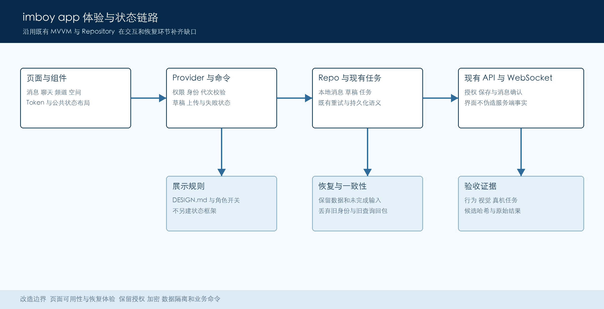

# Imboy App UI UX 优化方案

> 原始方案编制于 2026-11-11；实际进展与待验收事项以 PR 说明及审查台账为准。

<table>
<colgroup>
<col style="width: 30%" />
<col style="width: 3%" />
<col style="width: 30%" />
<col style="width: 3%" />
<col style="width: 30%" />
</colgroup>
<tbody>
<tr>
<td><h3 id="状态">状态</h3>

建议稿 V1
</td>
<td></td>
<td><h3 id="负责人">负责人</h3>

待指定
</td>
<td></td>
<td><h3 id="更新日期">更新日期</h3>

2026年11月11日
</td>
</tr>
</tbody>
</table>

|          |                                                   |
|----------|---------------------------------------------------|
| **编制** | Codex 依据当前仓库源码与规范编制                  |
| **评审** | 建议由产品 Flutter 与测试负责人共同评审           |
| **依据** | DESIGN.md 页面审查台账 测试执行合同               |
| **范围** | 移动端高频体验与状态恢复 兼顾企业空间及跨端一致性 |

# 1 方案摘要

建议沿用现有 iOS 原生感与品牌蓝，先修复会造成误操作、草稿丢失或失败无出口的问题，再统一消息、聊天、频道与空间切换的交互。现有规范和共享组件已较完整，重点是让已设计的能力在真实场景中稳定可用。

本次为规划交付。源码基线为 imboyapp da7ae435e738d463c38dbd778315622d6d6987f7，勘察开始时工作区干净。主要用户为个人聊天用户与企业成员；管理员、客服沿用各自权限。文中目标均为拟议验收值。本次未运行 App 功能测试或用户测试。

# 2 目标与范围

| **目标** | **本期边界** |
|----|----|
| 关键任务可完成 选点 编辑 重试均有可靠出口 | 先修已证实路径 不按页面数量制造改动 |
| 首要内容清晰 消息优先 空间身份持续可见 | 保留个人与企业入口及现有功能开关 |
| 窄屏 大字 暗色与读屏均可完成核心任务 | 复用 Token 和组件 不更换品牌或重建主题 |
| 改造可回归 可分批交付 可按功能回退 | 不改协议 权限或加密策略 不新增持久层 |

## 2.1 本地集成交付补充（2026-11-14）

原方案及 UX01–UX06 验收要求保留。用户后续提供的消息多选、转发截图纳入本次 App 交付：选择模式显示取消和已选数量，选择状态清晰可辨，底部操作区与转发弹层参考截图；逐条转发与合并转发必须走既有消息、附件授权及加密链路。弹层确认时重新核对当前消息状态，不得转发已撤回、不可转发或解密失败的消息。更多操作只展示实际可用能力。

最终候选以 App 主线 `6b4ae832dbab8f367298c3dd24dec2825abb8dac` 为集成起点，合入空间菜单修复、已采用的完整 406 份 Golden 基线（相对此集成基准有 394 张图片差异）、多选交互和必要测试修复；保留主线已有转发安全语义。原 Draft PR `a9095a5` 及其他源码指纹下的结果保留为历史证据，不能直接计入新候选验收。

验收还需覆盖小米真机上的选择、取消、弹层返回、逐条与合并跨账号收发，以及窄屏、大字、暗色和读屏；接收端核对消息数量、顺序、内容和附件权限。原方案的六个父旅程及适用完整检查仍须完成，专项通过不能代替整体通过。实际运行后端必须支持合并转发，并与冻结输入、运行制品及测试入口建立可核验的绑定。本补充不表示这些验收已通过，也不改变并行 Web MVP 专项范围。

# 3 当前基础与问题判断

当前个人底栏已包含消息、联系人、频道与我的，频道受功能开关控制。消息页已有统一列表、筛选、长按和局部失败提示；空间菜单已有切换忙碌态与重试；设置和资料已采用分组布局。这些能力应保留并补齐验证，不重复建设。

DESIGN.md 已引用 221 个去重页面承载文件与 563 项检查记录；CSV 实有 226 行记录，包含额外页面类和排除项，不能直接当页面数或通过数。台账含 8423aeaa 与 fd4d7671 等审查基准，需逐项对照当前源码。以下六项经本次静态抽样复核，表示可达的风险路径，仍需受控复现。[^1]

| **优先级与编号** | **当前风险** | **优化与行为验收** |
|----|----|----|
| P0 UX01 位置选择 | 换搜索词清空列表与序号，仍保留旧发送对象 | 清除旧选择；新结果需重选；搜索 B 无结果时不得发送 A |
| P0 UX02 频道草稿 | 迟到加载直接重写名称 标签及头像状态 | 加载与编辑分离；输入后旧回包不覆盖；返回时提示未保存修改 |
| P1 UX03 频道头像 | 上传失败保留新文件预览，保存仍可能用旧地址 | 区分本地预览 上传中 失败 已同步；失败可重试或还原 |
| P1 UX04 选好友 | 加载只在成功路径结束 busy，异常缺少页面出口 | 异常停止加载并显示重试；成功空结果展示空态 |
| P1 UX05 内置网页 | 有标题时无容器进度；错误只回调 无页面恢复 | 主文档失败显示重试与返回；资源错误不误判整页失败 |
| P2 UX06 综合搜索 | 桌面搜索的联系人 群 会话异常返回空列表 | 保留成功分组；失败分组可重试；移动搜索同类路径另核查 |

# 4 体验架构与页面方案

图1 既有页面与数据链路中的优化位置

### 模块职责与改造落点

| **模块** | **界面改造** | **复用能力** | **失败与恢复** |
|----|----|----|----|
| 消息与搜索 | 清晰身份 标题 预览和未读层级 | MessageInboxTile 与筛选栏 | 保留已加载会话 局部重试 |
| 聊天与附件 | 单一发送主操作 行内进度和失败入口 | chat_input 现有重试与附件授权 | 保留草稿 仅重试失败项 |
| 频道与群协作 | 编辑保护 上传一致性 角色化操作 | channel_edit 与已有发布队列 | 不把待确认提交标为成功 |
| 空间与企业 | 当前空间常驻 菜单内完成切换 | workspace_drawer_menu 与切换控制器 | 失败保留原空间 屏蔽旧回包 |
| 我的与公共容器 | 表单反馈 网页恢复与无障碍 | ios_settings_ui AsyncStateView | 可滚动 可返回 可重试 |

消息页 沿用“全部 未读 私聊 群聊 频道”及本地名称或预览检索，历史消息搜索保持明确入口。标题优先，预览与时间退为次级；大字号把元信息移到预览下方。筛选不推进已读；频道目录隐藏操作保留撤销。

聊天页 顶部保持会话身份与返回，底部保留文字 语音 附件入口。发送中显示状态，失败消息就地提供重试；系统键盘或工具面板切换后不丢输入。上传失败不得清除待发内容，已发送项不重复投递。

频道与群 浏览 订阅 管理按角色提供入口。编辑保存必须对应当前草稿；头像失败时写清“尚未上传”，允许重试或还原。成员搜索须说明全量或当前页范围，不能用当前页过滤伪装全量搜索。

空间与我的 切换前后都能识别个人或企业身份；切换中单飞，失败留在原空间。设置按个人资料 安全隐私 通知 账号管理保持分组；危险操作说明对象与后果，并沿用确认步骤。

视觉规则 延用品牌蓝与系统蓝的职责区分，页面级实心主按钮用 primaryDark。颜色 间距 字号沿用 AppColors AppSpacing FontSizeType；灰色不单独表达禁用或错误。明暗主题 使用中性表面与细分隔，避免添加装饰卡片。

# 5 核心用户流程与交互细则

1.  找到并回复消息 进入消息页后先识别空间；筛选或搜索再打开会话；输入发送后以既有消息回执更新状态。验收覆盖私聊 群聊 个人频道，搜索与筛选不清未读，不混入无权访问的内容。

2.  发送位置 选择 A 后改搜 B，应立即清除 A 的选择；B 加载中或无结果时不可发送旧位置，并解释“请选择位置”。只有当前结果被选中才可提交；快速切词仅接纳最新查询结果。

3.  编辑频道 带缓存进入时显示已有内容；编辑产生 dirty 后后台刷新不得覆盖。保存中防重复；失败保留草稿；成功以返回模型核对。返回手势与返回键都检查未保存修改。

4.  更换头像 选择后标注上传中；失败保留可恢复草稿但明确未同步，提供重试与还原。保存前须处理头像失败状态；不允许新预览配旧保存结果却显示全部成功。

5.  恢复加载失败 选好友与网页首次失败显示原因和重试；已有数据刷新失败时保留数据并就地提示。空态只用于请求成功且确实为空；错误提示采用用户能执行的动作，不展示底层异常字符串。

6.  切换空间 从全局空间入口打开菜单，选择目标后显示切换中；成功才更新当前空间并关闭本层菜单。失败保留当前空间和缓存。账号切换或退出后，旧请求不得把数据写回新身份。

7.  首次使用与敏感动作 登录表单校验贴近字段；权限在使用录音 相机或定位时解释用途，拒绝后提供系统设置入口。新设备密钥恢复与备份沿用安全策略；仅优化说明和恢复入口，不弱化保护。

# 6 界面状态与数据契约

### 状态来源与展示要求

| **状态或标识** | **来源** | **适用** | **界面合同** |
|----|----|----|----|
| 空间身份 | 账号与服务端 | 全局 | 账号 服务器 空间联合隔离；切换失败保留原身份 |
| 加载状态 | Provider 或请求 | 列表 | 区分首载 刷新 更多；保留成功内容 |
| 错误与空结果 | 真实返回或异常 | 列表 | 仅成功空显示空态；失败给恢复动作 |
| 草稿状态 | 当前编辑会话 | 表单 | dirty 后不被旧回包覆盖；退出可保留或放弃 |
| 上传状态 | 现有附件任务 | 媒体 | 区分本地 上传中 失败 完成；预览反映状态 |
| 消息状态 | 消息存储与回执 | 消息 | 真实未读与人工待处理分开；不制造回执 |
| 权限状态 | 服务端事实 | 管理 | 按钮文案 视觉 语义与实际可用性一致 |

### 接口与兼容保证

1.  本表为展示语义，不要求新增同名字段或统一状态引擎。优先使用已有模型；仅当模型无法区分空与失败时，定向扩充原 Provider 并核对调用方。

2.  继续复用现有 API WS Repo 和附件任务标识。消息 ID 保持 String；不改为 int，不通过界面顺序或缓存推断权限。

3.  频道保存 位置选择和空间切换均验证当前账号 目标对象与请求代次；旧查询或旧身份的回包不更新当前 UI。

4.  界面反馈不能代替服务端确认。重试继续调用原命令；回执丢失时先沿既有路径核对，确认可重试后再执行。

契约依据为仓库现有实现与 DESIGN.md；API 变更需单独评审。

[<u>官方参考 Flutter 无障碍界面设计</u>](https://docs.flutter.dev/ui/accessibility/ui-design-and-styling)

# 7 一致性 重试与恢复

优化的核心约束是“用户看到的状态与实际动作一致”。仅禁止重复点击不能保证服务端幂等；实现时保留已有命令和消息队列语义。每项修复都应以明确输入、故障触发和最终数据结果为验收依据。

| **场景** | **预期行为** | **验收依据** |
|----|----|----|
| 连续点击保存或重试 | 忙碌期间只执行一次 原输入保留 | 记录调用次数 成功只出现一个结果 |
| 上传或持久化失败 | 不显示已同步 不清除草稿 | 重进页面核对真实保存值与预览 |
| 超时或部分成功 | 展示待确认或对应失败 仅重试必要项 | 验证已完成项无重复业务副作用 |
| 切换账号或查询词 | 旧回包被丢弃 当前页状态不被污染 | 延迟响应与交错返回的定向测试 |

# 8 权限与隐私约束

1.  个人空间 企业工作区 客服会话分别沿用现有授权。无权限是只读或拒绝，不给无效重试。隐藏按钮不能代替服务端权限校验。

2.  截屏 测试和可用性记录只用合成账号；不记录消息正文 地理坐标 邀请码或完整附件 URL。若新增体验统计，只采集必要的动作与时延。

3.  附件预览继续走 AssetsService.viewUrl 或已封装授权组件；不得为了提速展示绕过授权的地址。密钥 凭据与一次性授权码不进入 UI 日志。

4.  位置与相机权限按需请求；拒绝时说明影响并允许退出。网页恢复只重载当前可信导航上下文，不扩大桥接能力或修改 origin 校验。

5.  危险操作沿用确认；界面清除 缓存隐藏 退订与永久删除必须分别说明。任何删除 保留期限或数据可见范围政策变化均另行评审。

# 9 验收与发布准备

<table>
<colgroup>
<col style="width: 21%" />
<col style="width: 33%" />
<col style="width: 22%" />
<col style="width: 22%" />
</colgroup>
<thead>
<tr>
<th><strong>检查信号</strong></th>
<th><strong>拟议验收目标</strong></th>
<th><strong>负责角色</strong></th>
<th><strong>门禁</strong></th>
</tr>
</thead>
<tbody>
<tr>
<td>关键用户任务</td>
<td>5至8名自愿参与者完成六项任务；每项至少80%独立完成</td>
<td>产品与测试</td>
<td>目标待评审</td>
</tr>
<tr>
<td>反馈与性能</td>
<td>点击100ms内反馈；同设备脚本帧耗时不劣化基线10%以上</td>
<td>Flutter</td>
<td>受控测量</td>
</tr>
<tr>
<td>布局与无障碍</td>
<td>320 360 390宽；100% 150% 200%字；明暗态无阻断</td>
<td>设计与测试</td>
<td>必须</td>
</tr>
<tr>
<td>功能与数据</td>
<td>草稿不丢 位置不误发 失败可恢复 无重复提交</td>
<td>Flutter与测试</td>
<td>必须</td>
</tr>
<tr>
<td>最终候选回归</td>
<td>定向用例 PR分片 full矩阵；必需项无失败或缺失</td>
<td>测试负责人</td>
<td>必须</td>
</tr>
<tr>
<td colspan="4">推广约束 先内部合成账号验证，再经另行授权的小范围试用；严重问题回退对应 UI 改动。真实通知 外部发布及生产操作须人工确认。</td>
</tr>
</tbody>
</table>

# 10 方案取舍

| **备选** | **收益** | **本方案取舍** |
|----|----|----|
| 全量视觉改版 | 风格变化明显 | 已有规范与改造成果较多；本期先闭环高频风险 |
| 仅调整颜色和间距 | 改动较小 | 不能解决草稿覆盖 误发和失败无出口 |
| 新增通用状态框架 | 跨页形式统一 | 优先复用原 Provider 和组件 避免增加迁移成本 |
| 只做截图对比 | 容易观察视觉差异 | 同时保留行为 数据结果与真机验证 |

# 11 需要评审确定的事项

1.  首期验收以个人消息和聊天为主，企业空间切换同步覆盖；综合搜索等桌面专属项列入后续批次。由产品确认顺序。

2.  位置与频道草稿列为最高优先级风险；需受控复现后定级，不把静态路径直接算成线上事故。由测试明确故障注入方式。

3.  指定产品 Flutter 与测试负责人，确认真机和隔离后端资源；iOS 条件不足时明确阻塞，不用模拟器替代功能验收。

4.  确认参与可用性测试的人群和目标。未经确认不邀请用户 不外发版本；工期估算在定向复现与资源就绪后给出。

# 12 决策与实施顺序

建议按四个里程碑推进。每批先复核缺口，再实现最小完整修复，更新原检查台账并保留回归用例。共享组件变更同时检查直接调用方；最终集成候选统一执行适用全量门禁。计划通过评审后再进入实施。

| **里程碑** | **交付** | **退出条件** |
|----|----|----|
| M1 风险复现 | UX01位置 UX02草稿 最小复现与修复 | 故障前后结果可对照 无误发或草稿丢失 |
| M2 状态闭环 | UX03头像 UX04选好友 UX05网页恢复 | 失败 空态 成功可区分；定向回归通过 |
| M3 体验一致 | 高频页面的大字 暗色与读屏适配 | 关键任务与布局矩阵通过；原功能保留 |
| M4 候选验收 | full矩阵 真机旅程 可用性试用与回退验证 | 必需项齐全；发布另行授权；UX06按平台收尾 |

### 源码与验证索引

UX01 lib/component/location/widget.dart 的 \_searchKeyword 与 \_handleSend。回归需覆盖更换关键词 空结果 请求交错与页面退出。

UX02 UX03 lib/page/channel/channel_edit_page.dart 的 \_loadChannel \_pickAvatar \_uploadAvatar 与 \_saveChanges 路径。回归覆盖编辑中回包 上传失败 重试和返回。

UX04 lib/page/chat/widget/select_friend.dart 的 loadData。UX05 lib/component/web_view.dart 的 onProgress 与 onWebResourceError。网页区分主文档和资源请求失败，并检查所有现有调用方。

UX06 lib/page/search/web_search_page.dart 的 \_searchContacts \_searchGroups \_searchConversations。来源台账检查项为 page-state-024；此项属桌面综合搜索，不能直接归为移动端现有缺陷。

复用与规范 DESIGN.md 第8 9 11章；docs/design/uiux-page-review.csv 与 uiux-review-checkpoints.csv；MessageInboxTile AsyncStateView ResourcePageLayout 和 workspace_drawer_menu。

验证落点 复用 test/uiux test/ux_matrix 及 test/unit_test/page 下对应家族。新增缺陷回归必须验证行为和最终状态；Golden 只证明固定环境下的视觉差异。全量归属以 docs/testing/execution.md 与执行合同为准。

执行记录需绑定候选哈希 命令 原始退出码 计数与跳过项；必需环境缺失记为阻塞，不计通过。

真机旅程包括消息重试 位置更换 频道编辑 头像失败 网页恢复和空间切换，复核权限 读屏 返回手势与键盘遮挡。

官方参考 读取于2026年11月11日。Android触达48×48dp，iOS触达44×44pt；系统字号放大后仍须可用。Flutter设计参考见第6节。

https://docs.flutter.dev/ui/accessibility/accessibility-testing

Apple UI Design Dos and Don’ts https://developer.apple.com/design/tips/

[^1]: 本文区分既有能力 静态风险与拟议验收目标；源码审查不等于真机验收。

本次 UI 候选范围为消息多选与转发、合并消息附件查看、空间菜单、频道头像作用域，以及必要的附件授权解密和 E2EE 就绪依赖；保留主线 PR #70 等待草稿保存的处理。采用 406 份基线不等于原生父旅程验收通过；无关 API/支付修复与未完成头像原生入口不纳入本候选。最终候选集成检查仍待执行。
